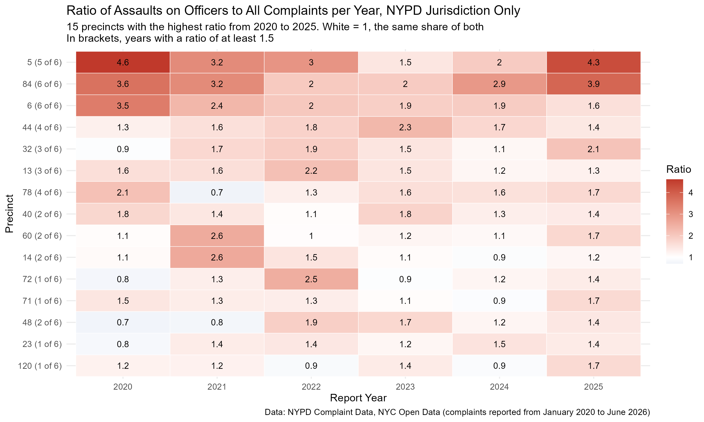

# Checkpoint 2: Hypothesis 2

**Research question:** Where and when are assaults on police and peace officers concentrated?

- **Code, criterion and full results:** `R/Hypothesis_2_ale.R` (Check 12)
- **Figures:** `fig/02_exploration/02_ale/02_police_victims/`

---

## Revised hypothesis (supported)

> Under NYPD jurisdiction, assaults on officers concentrate every year in the same small group of precincts, above the share those precincts have of all complaints. A precinct counts as concentrated when its ratio is at least 1.5 in at least 5 of the 6 years (2020 to 2025).

The criterion was fixed before running the code.

## What changed

I added Check 12. It computes the ratio per precinct and per year, only under NYPD jurisdiction, and counts in how many years each precinct reaches 1.5. Only precincts with at least 50 assaults are evaluated. Concentration and persistence now use the same measure.

## Results

3 of 67 precincts meet the criterion. Precincts 6 and 84 reach 1.5 in all 6 years and Precinct 5 in 5. This means that, in almost every year, these precincts have a share of the city's assaults on officers at least 1.5 times larger than their share of the city's complaints. Together they hold 8.1% of assaults but only 3.1% of all complaints, so assaults on officers are about 2.6 times more concentrated there than their volume of crime would suggest. Precincts 44 and 78 reach 1.5 in 4 years.

Figure file: `fig/02_exploration/02_ale/02_police_victims/assaults_ratio_by_year_nypd.png`

The figure shows the ratio per year for the 15 precincts with the highest ratio. White is 1, red is above 1. The number in brackets is how many years each precinct reached 1.5. It evolves from two checkpoint 1 figures, the counts per year (`assaults_by_year.png`) and the ratio over the whole period (`assaults_ratio.png`), and now shows both parts of the hypothesis with the same measure.

---

## Discarded hypothesis

- **Adults using children to commit crimes:** the data does not record whether an adult directed a suspect, and suspects under 18 were too few in drug complaints (481 of 73,125 with a known age). Code in `R/youth_complaints.R`.
