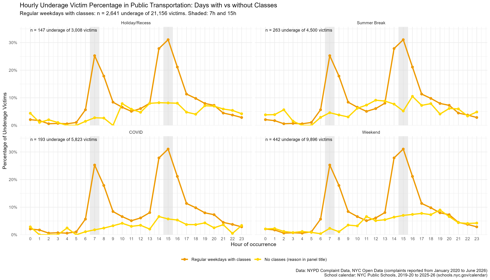
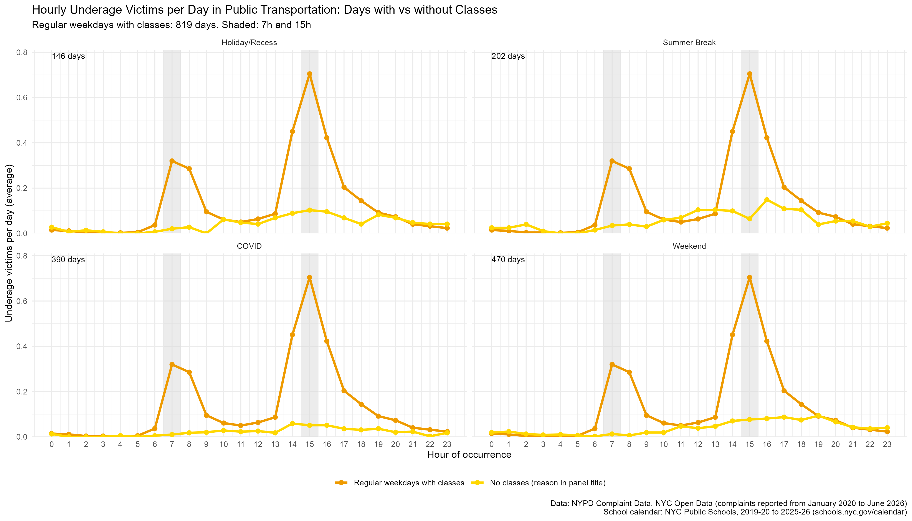
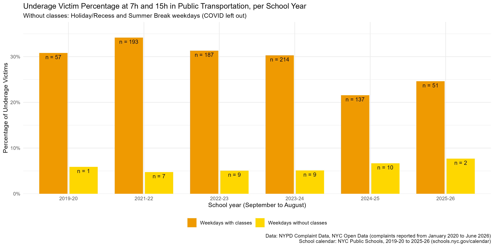
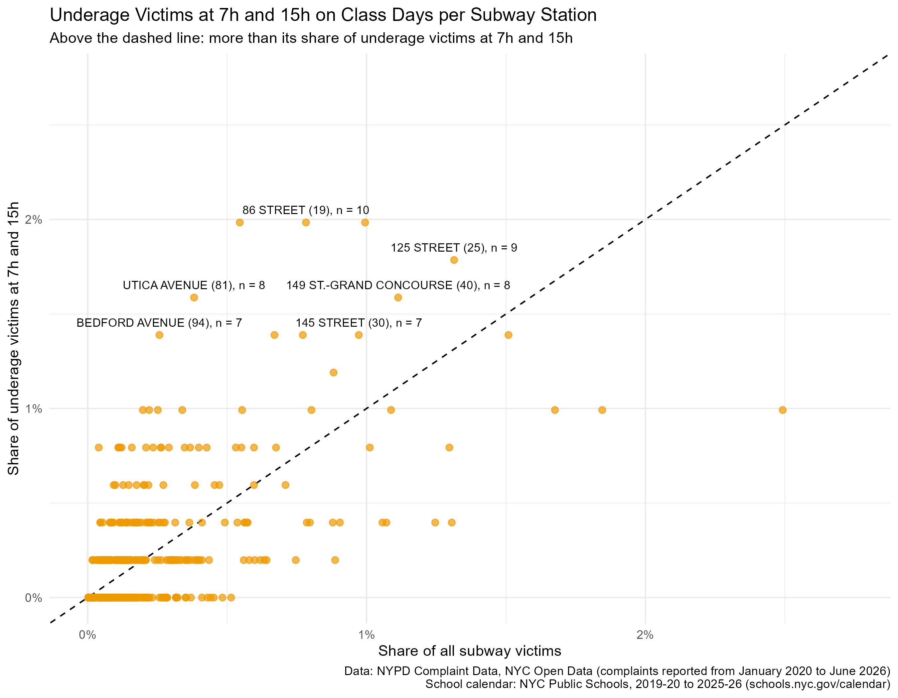
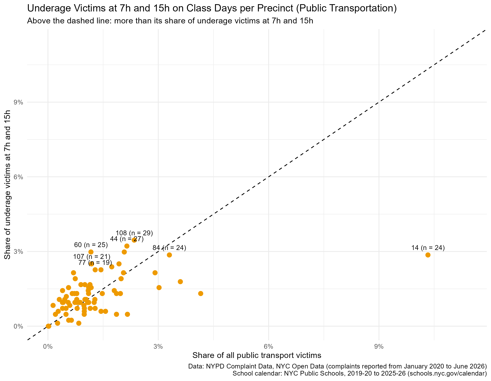
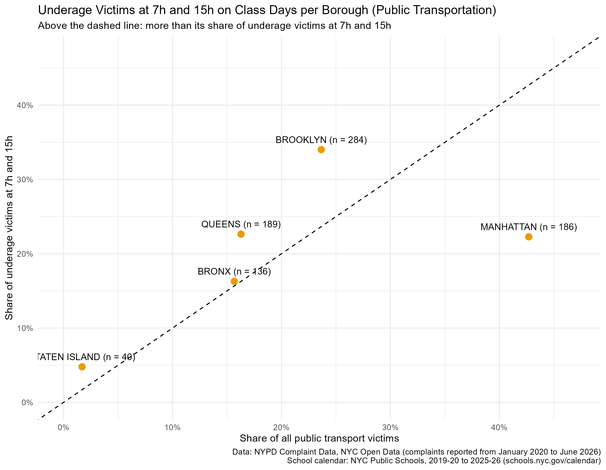
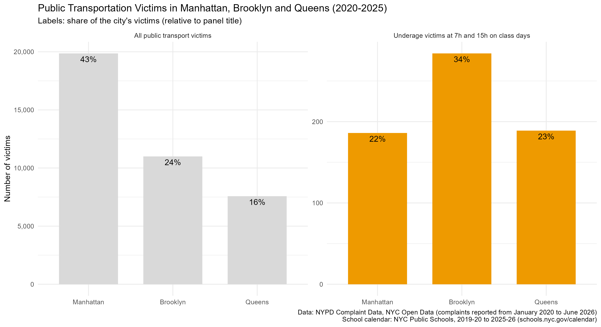

The main problem with the original proposal was that "commute" and "unsupervised after-school time" were interpretations the data never actually records, so I took them out of the hypothesis (they only come back in the discussion) and also dropped the residence part, which stays as a documented discard. As a result, residence and commute were removed from the rationale, and with them the school-based solutions, which, as the professor pointed out, assumed who the aggressor was.

To turn school days into a real variable, I employed a Claude agent to build the NYC public school calendar from 2019-20 to 2025-26, mostly from the official NYC Public Schools calendars (news sources for 2019-20 and the COVID dates), with a source for every date, and joined it to the complaints. This way, each date is labelled either as a regular class day or as a day without classes, for one of these reasons:

 1. Holiday/Recess
 2. Summer Break
 3. COVID
 4. Weekends

(COVID weekends and days when only some grades were off are left out.)

Furthermore, percentages now feature counts (as requested), and the per-day plot shows the peaks also hold in the actual number of victims and not just in their share.

For the refutation criterion, I used a threshold stricter than the professor's suggestion for H2 (share with classes above 1.75x as opposed to 1.5x, in at least 5 of the 6 school years), set after the first run. As can be seen, every school year passes, with around 30% of victims at 7h and 15h being under 18 on class days against about 5% on weekdays without classes in most years, always beating the 1.75x ratio by a large margin (the lowest is about 3x). The only caveat is that 2019-20 and 2025-26 are partial school years and rest on very few victims without classes.

At first, the pattern looked global: underage victims at 7h and 15h on class days are spread across precincts and subway stations, with no station reaching more than 10 victims in six years, and only a few precincts (60, 107 and 77) reaching about twice their share, with 19 to 25 victims each. The difference only shows up at the borough level. Manhattan concentrates 43% of all public transport victims in the city, but only 22% of the underage victims at those hours (n = 186), while Brooklyn goes from 24% to 34% (n = 284) and Queens from 16% to 23% (n = 189). The Bronx sits right where expected, and Staten Island is above its share but with only 40 victims. In other words, the problem isn't concentrated in specific stations, but it isn't evenly spread either: it leans towards Brooklyn and Queens and away from Manhattan, where most public transport crime happens. This matters for patrols, since reinforcing them based on general public transport crime would focus on Manhattan, precisely where this problem is least concentrated. The more useful answer to "where and when" is the class-day hours of 7h and 15h across the network, with more weight on Brooklyn and Queens.

If the professor eventually gives us more information on how to specifically improve the parts mentioned below (considering the phenomenon leans towards Brooklyn and Queens rather than Manhattan, but is spread across precincts and subway stations rather than concentrated in a few of them), I'd be glad to implement them:

> The questions of interest are conditional: where do offences concentrate, at what hours and on which days, in what kinds of places, for which types of offence, and how have these patterns changed since 2020? The visualizations you build should turn such patterns into evidence for concrete decisions, such as where and when to reinforce patrols, which kinds of premises need prevention measures, or which types of offence are growing and where.
>
> You get points based on the quality of the report/dashboard, the difficulty of the problem you are addressing and the novelty of your solution(s)