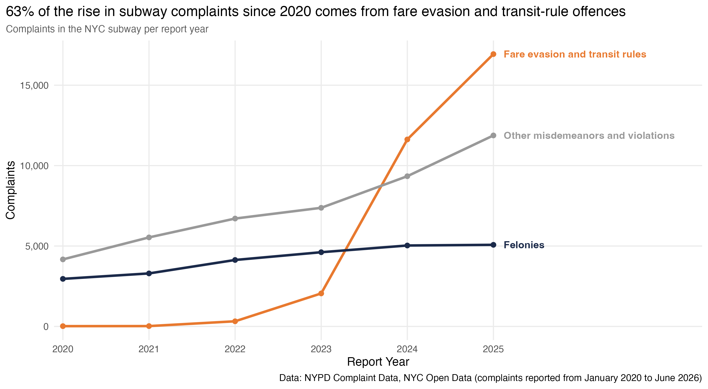
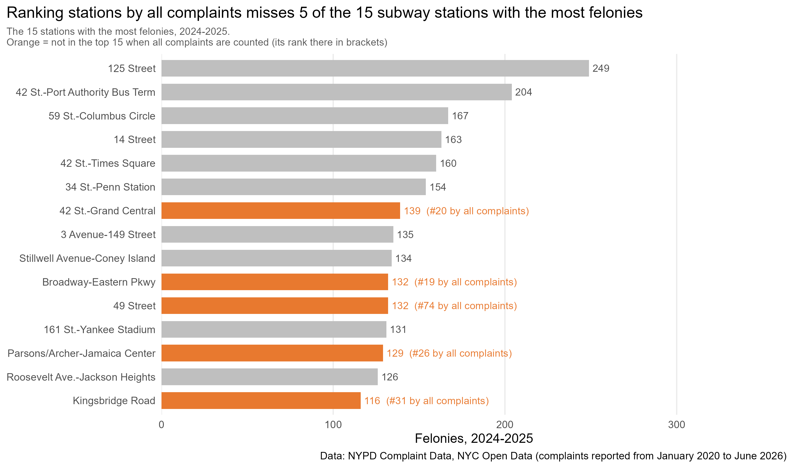

# Checkpoint 2: Hypothesis 4

**Research question:** Is the rise of complaints in the NYC subway since 2020 a rise in felonies, or a rise in fare evasion and transit-rule offences?

**What changed after the feedback:** The professor pointed out that "enforcement" already assumed a cause the data cannot show, since a rise in fare evasion complaints can mean more evasion or more police checks. It was removed from the hypothesis, the code and the figures, and the group is now named after its two offence classes. "Mostly" now has a threshold (more than 50% of the rise), set after the first results. The station ranking was also checked for 2024 and 2025 separately.
 

- **Code:** `R/Hypothesis_4.R`
- **Exploration that led to the hypothesis:** `R/exploration_bea.R`
- **Figures:** `fig/02_exploration/hypothesis_4/hypothesis/`

**No hypothesis was discarded.**

---
## H4.1: the rise comes from fare evasion and transit rules (supported)

> More than half of the rise of complaints in the NYC subway since 2020 comes from two offence classes: theft of services (fare evasion) and N.Y.C. Transit Auth. R&R (transit rules), and not from felonies.

63% of the rise comes from these two classes, which went from 17 complaints in 2020 to 16,934 in 2025. Felonies also grew, but less (x1.7).

## H4.2: a ranking by total complaints leaves out stations with many felonies (partly supported)

> A ranking of stations by total complaints leaves out stations where felonies are high.

In 2024-2025, 5 of the 15 stations with the most felonies are not in the top 15 by total complaints. 49 Street, for example, is 10th by felonies but 74th by total complaints.

As asked in the feedback, the ranking was also checked year by year. The total leaves out 4 stations in 2024 and 4 in 2025, but never the same ones. So the effect holds, but the list of stations changes from one year to the next.

The other figures (felony index, hour and weekday, month, borough) are in the same folder and keep their names. Only their labels changed.

---

## What the Mayor and the NYPD could do
Place patrols against violent crime by felonies, not by total complaints, and redo the station ranking every year, since the stations left out change. The next step is to divide each station's felonies by the number of people who enter it, using data from the MTA. This would show which stations are riskier per person, and not only which have more cases.
