# Hypothesis: Spikes in Complaints with Underage Victim Spikes in *"Residence - Institution - Residence"* Commutes

## 1. Settings
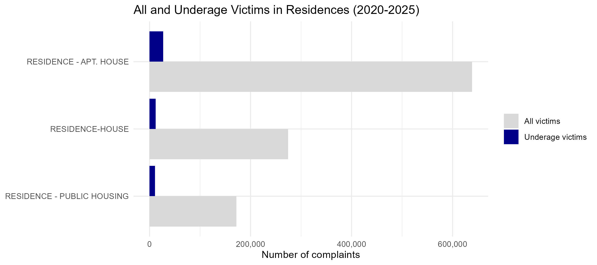
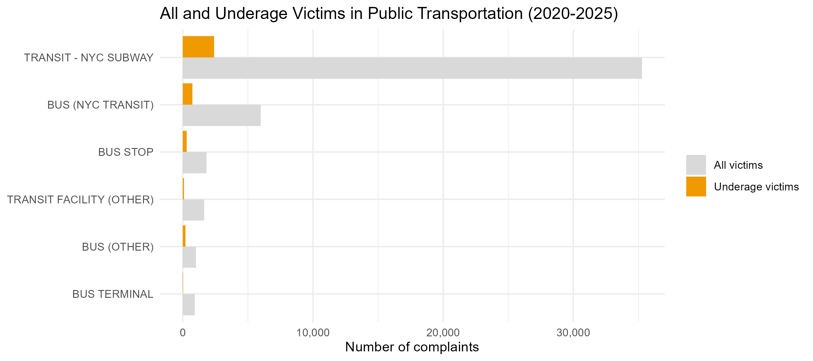

## 1.1 Percentage of underage victims, by setting
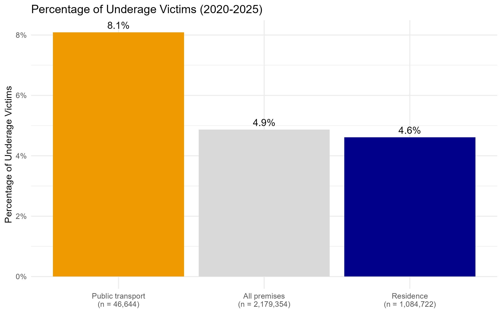

## 2. Underage victims on weekdays, by hour: residences
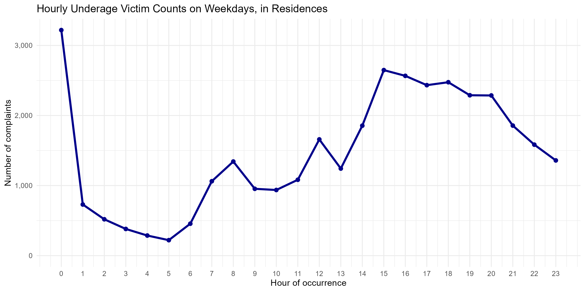

## 2.1 Underage victims on weekdays, by hour: public transport
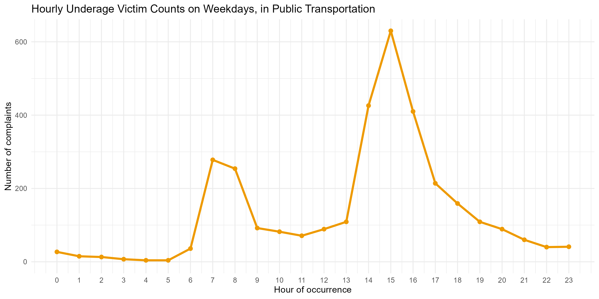

## 3. Weekday vs weekend: residences
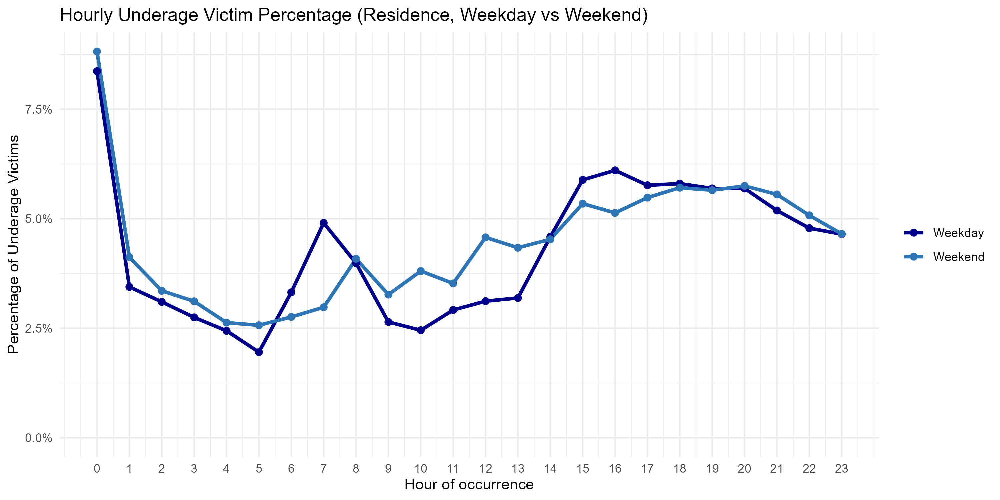

## 3.1 Weekday vs weekend: public transport
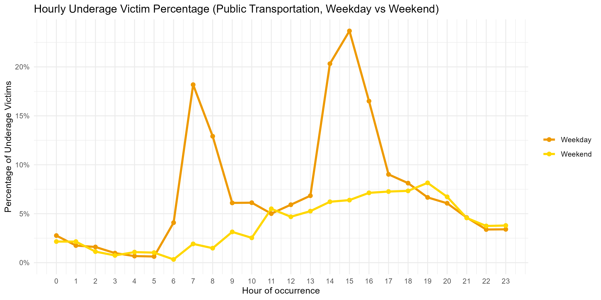

## 4. School months vs summer: residences
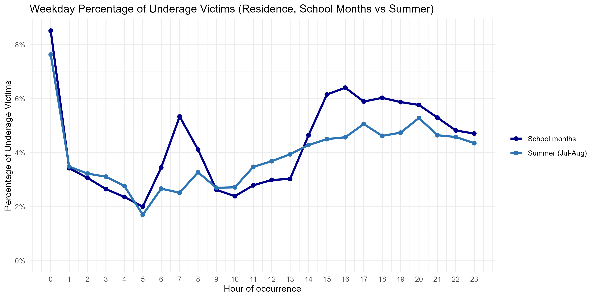

## 4.1 School months vs summer: public transport
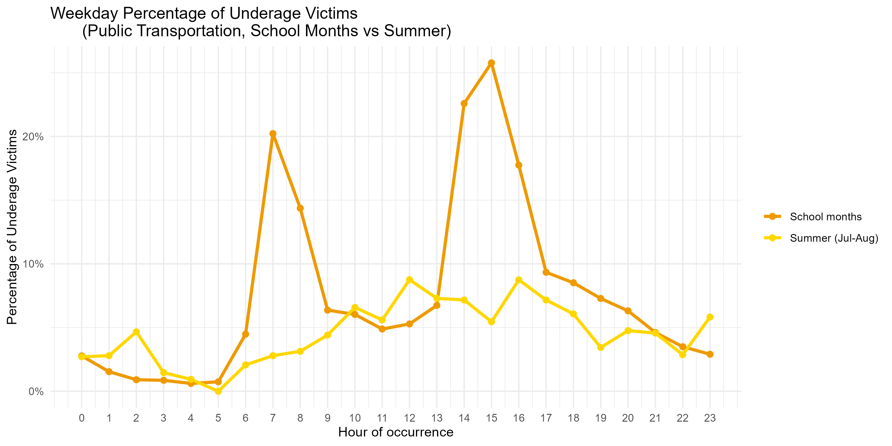

## 5. Offence levels of underage victims, by setting
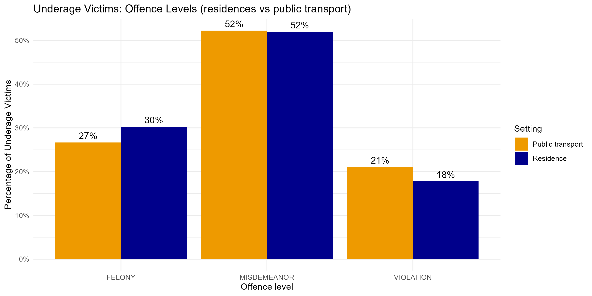

## 6. Top 10 offences against underage victims, by setting
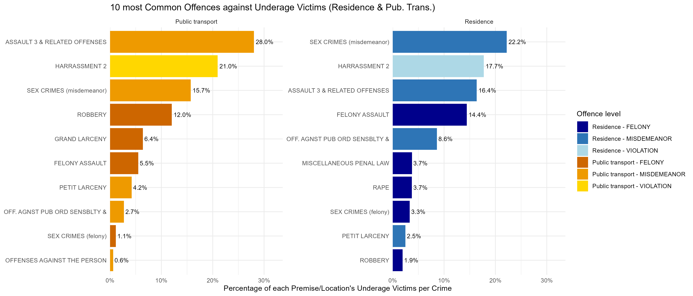
